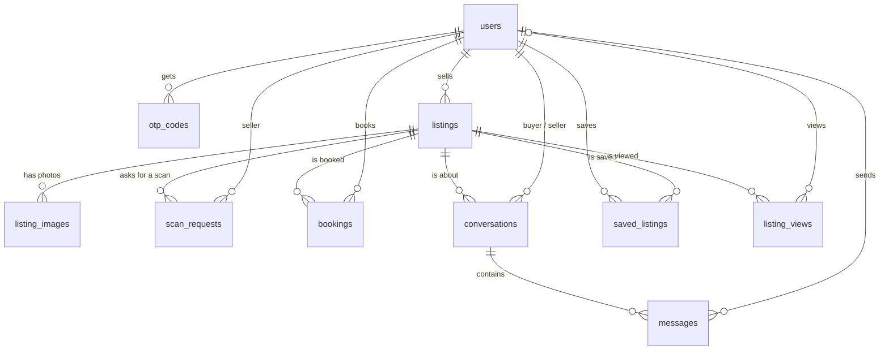

# Database

PostgreSQL 16. Tables are created by the SQL files in `server/db/migrations/`, run in name order
by `npm run db:migrate -w server`. Sample data: `npm run db:seed` (empties every table first).

**Rules**

- Never edit a migration that has been merged. Add a new numbered file (`004_...sql`).
- Column names are `snake_case`. The API sends them as `camelCase` (`full_name` → `fullName`).
- Every status and type value must match `shared/constants.js`.
- Only `*.service.js` files run SQL, and always with `$1, $2` parameters, never by joining strings.

## Migrations

| File | What it does |
|---|---|
| `001_init.sql` | All 8 tables and their indexes |
| `002_message_read_at.sql` | `messages.read_at` (for unread counts) and indexes on `conversations.buyer_id` / `seller_id` |
| `003_otp_attempts.sql` | `otp_codes.attempts` (wrong OTP guesses; the code is used up after 5) |
| `004_saved_listings.sql` | `saved_listings`: each user's saved homes (the heart button) |
| `005_listing_views.sql` | `listing_views`: listing page views and 3D tour opens (seller stats) |
| `006_seller_verification.sql` | `users.seller_verified_at` and `seller_verified_by` ("Verified seller" badge) |

`schema_migrations` (made by the migration runner) remembers which files already ran.

Not in the database: **nearby places** (`GET /api/listings/:id/nearby`) come from OpenStreetMap and
are cached in server memory for 24 hours, keyed by listing id and location. No table, no migration.

## How the tables connect



Deleting a listing also deletes its photos, scan requests, bookings and conversations
(`ON DELETE CASCADE`) and its views. Deleting a user deletes their OTP codes.

## Tables

### users

| Column | Type | Notes |
|---|---|---|
| id | SERIAL | primary key |
| full_name | TEXT | required |
| email | TEXT | required, unique, saved in lower case |
| phone | TEXT | optional |
| password_hash | TEXT | bcrypt hash; never sent by the API |
| role | TEXT | `buyer`, `seller` or `admin` (`ROLES`). Admins can't sign up; they are added by hand or by the seed |
| is_verified | BOOLEAN | `true` after the email OTP is entered ("Email verified" badge) |
| created_at | TIMESTAMPTZ | |
| seller_verified_at | TIMESTAMPTZ | sellers only: when an admin checked their documents in person ("Verified seller" badge). `NULL` = not verified |
| seller_verified_by | INT → users | the admin who verified them; `NULL` if not verified (or that admin was deleted) |

"Verified tour" has no column: a listing has it when one of its `scan_requests` is `published`.

### otp_codes

| Column | Type | Notes |
|---|---|---|
| id | SERIAL | primary key |
| user_id | INT → users | |
| code_hash | TEXT | bcrypt hash of the 6-digit code; the code itself is never stored |
| expires_at | TIMESTAMPTZ | 10 minutes after it is made (`LIMITS.OTP_EXPIRY_MINUTES`) |
| used_at | TIMESTAMPTZ | set when the code is accepted, or after 5 wrong tries |
| attempts | INT | wrong guesses so far (migration 003) |

Only the newest unused, unexpired code counts, so "Resend" makes older codes useless.

### listings

| Column | Type | Notes |
|---|---|---|
| id | SERIAL | primary key |
| seller_id | INT → users | always taken from the login token, never from the request |
| title, description | TEXT | |
| type | TEXT | `sale`, `rent`, `short_stay` (`LISTING_TYPE`) |
| status | TEXT | `draft`, `awaiting_scan`, `live`, `archived` (`LISTING_STATUS`); see below |
| price | NUMERIC(14,2) | rupees; per month for rent, per night for short stays |
| district | TEXT | one of `DISTRICTS` |
| address | TEXT | |
| lat, lng | DOUBLE PRECISION | for the maps; optional |
| bedrooms, bathrooms, area_sqft | INT | optional |
| tour_url | TEXT | `/uploads/tours/<id>.glb`, set when the 3D tour is published |
| created_at | TIMESTAMPTZ | |

Index `idx_listings_search (status, type, district, price)` serves the search page.
Only `live` listings appear in search and compare, and only their seller and admins can open the others.

### listing_images

| Column | Type | Notes |
|---|---|---|
| id | SERIAL | primary key |
| listing_id | INT → listings | |
| url | TEXT | `/uploads/listings/<listingId>/<file>` (or a full URL in seed data) |
| position | INT | order of the photos; the lowest (0) is the cover |

### scan_requests

| Column | Type | Notes |
|---|---|---|
| id | SERIAL | primary key |
| listing_id | INT → listings | at most one open request (pending, scheduled, scanned) per listing |
| seller_id | INT → users | |
| preferred_date | DATE | the seller's wish |
| scheduled_for | TIMESTAMPTZ | the visit the admin booked |
| notes | TEXT | gate code, who opens the door... |
| status | TEXT | `SCAN_STATUS`; see below |
| created_at | TIMESTAMPTZ | |

### bookings

| Column | Type | Notes |
|---|---|---|
| id | SERIAL | primary key |
| listing_id | INT → listings | live listings only, not your own |
| user_id | INT → users | who booked |
| kind | TEXT | `viewing` or `stay` (`BOOKING_KIND`); stays only on `short_stay` listings |
| date | DATE | viewing date, or check-in for a stay |
| check_out | DATE | stays only, after `date` |
| message | TEXT | optional, up to 1000 characters |
| status | TEXT | `requested`, `confirmed`, `declined`, `cancelled` (`BOOKING_STATUS`) |
| created_at | TIMESTAMPTZ | |

Two confirmed stays on the same listing can't overlap (checked when booking and when confirming).

The short-stay calendar (`GET /api/listings/:id/availability`) reads this table: stays that are
`requested` or `confirmed` block their nights `date` … `check_out - 1`. Only the dates leave the
server. No new columns or migration.

### listing_views

| Column | Type | Notes |
|---|---|---|
| id | BIGSERIAL | primary key |
| listing_id | INT → listings | `ON DELETE CASCADE` |
| viewer_id | INT → users | logged-in viewer; `NULL` for anonymous visitors. Set to `NULL` if the user is deleted, so the view still counts |
| kind | TEXT | `page` or `tour` (`VIEW_KIND`) |
| session_key | TEXT | random id of an anonymous visitor's browser; `NULL` when `viewer_id` is set |
| created_at | TIMESTAMPTZ | |

Index `(listing_id, kind, created_at)`: used both for the "already counted this hour?" check and
for the stats. The API writes at most one row per viewer (or session) per listing per kind per hour,
and never for the listing's owner. Only `server/src/modules/stats/` writes this table.

### saved_listings

| Column | Type | Notes |
|---|---|---|
| user_id | INT → users | part of the primary key |
| listing_id | INT → listings | part of the primary key, so a home is saved once per user |
| created_at | TIMESTAMPTZ | "newest saved first" on the Saved page |

### conversations

| Column | Type | Notes |
|---|---|---|
| id | SERIAL | primary key |
| listing_id | INT → listings | |
| buyer_id, seller_id | INT → users | |
| created_at | TIMESTAMPTZ | |

`UNIQUE (listing_id, buyer_id)`: one conversation per listing per buyer.

### messages

| Column | Type | Notes |
|---|---|---|
| id | SERIAL | primary key |
| conversation_id | INT → conversations | |
| sender_id | INT → users | must be the buyer or seller of the conversation |
| body | TEXT | up to 2000 characters |
| created_at | TIMESTAMPTZ | |
| read_at | TIMESTAMPTZ | when the other person read it; `NULL` = unread (migration 002) |

## Status flows

**Listing and scan request** (the main flow of the app):

```
Seller adds a property        listing: draft
Seller requests a scan        listing: awaiting_scan   request: pending
Admin books the visit                                  request: scheduled (scheduled_for set)
Team scans with the iPhone                             request: scanned
Admin uploads the .glb        listing: live + tour_url request: published
Cancelled at any open step    listing back to draft    request: cancelled
```

A request becomes `published` only by uploading its tour, so no listing goes live without a 3D file.

**Booking:** `requested` → the listing's seller sets `confirmed` or `declined`;
the person who booked can set `cancelled` while it is `requested` or `confirmed`.
